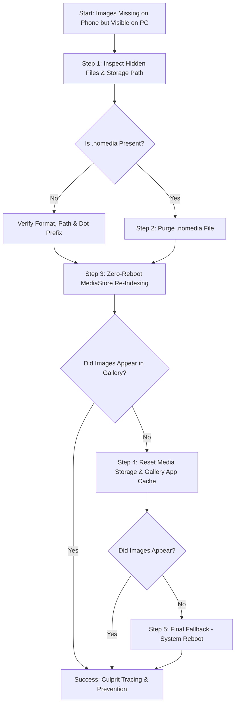

# NoMedia Sentinel: Real-Time Storage Watchdog & Culprit Identification Engine

## 1. Problem Statement: The Missing Media Paradox (PC vs. Android)

Users frequently encounter an unsettling anomaly on Android devices: **images and videos clearly present inside a folder when viewed on a PC over USB are completely invisible on the Android phone itself** (inside Gallery, Google Photos, or system file pickers).

This discrepancy stems from fundamental differences between how desktop operating systems and Android handle storage:

### Why the Discrepancy Occurs
1. **Raw Filesystem (PC) vs. Indexing Abstraction (Android):**
   * When connected to a PC via USB (MTP or Mass Storage), the computer queries the raw filesystem tree directly. If an image file exists on disk, the PC file manager renders it.
   * Android gallery apps **never** scan the physical storage tree directly. Instead, they query Android's centralized SQL database: the **`MediaStore` Content Provider**. If an image is not indexed in `MediaStore`, it does not exist to any gallery app.
2. **The `.nomedia` Exclusion Flag:**
   * In Android, the presence of a hidden empty file or folder named `.nomedia` serves as a directive to the system's `MediaScanner`. It commands the OS to drop the entire directory tree from `MediaStore` and exclude it from all future indexing passes.
   * Rogue third-party apps, ad SDKs, aggressive "cleaner" utilities, game asset downloaders, or backup sync tools frequently drop `.nomedia` files into standard shared media paths (such as `DCIM/Camera`, `Pictures`, or `Download`).
3. **Stale MediaStore Cache & Indexing Lag:**
   * Files transferred via MTP, downloaded by third-party browsers, or unzipped in the background do not automatically register in `MediaStore` until a scan event is dispatched.
4. **Scoped Storage Sandboxing (Android 10+ / 11+):**
   * Files placed inside app-isolated paths (e.g., `Android/data/`, `Android/obb/`, or private sandboxes) are strictly hidden from gallery apps by OS policy, even though PC MTP connections often expose them.
5. **Dot-Prefixed Hidden Items & Minimum Size Filters:**
   * Files or directories starting with a dot (`.filename.jpg` or `.folder/`) are treated as hidden system files. Furthermore, many OEM gallery apps enforce a minimum size threshold (e.g., ignoring images `< 50 KB` or `< 100x100 px`) to filter out cache icons.
6. **Culprit Anonymity:**
   * Android process sandboxing obscures which application dropped the `.nomedia` file. Users cannot easily deduce the source app to remove or configure it.

---

## 2. Comprehensive Remediation Plan to Fix Missing Images

To recover missing media, users should follow this ordered sequence. **Non-reboot solutions are attempted first; restarting the phone is strictly reserved as the final fallback step.**



### Step 1: Inspect Hidden Files, Paths, and File Formats
1. Open a capable file manager on the phone (or PC file explorer) and enable **"Show hidden files"**.
2. Verify the folder location:
   * Ensure files are in standard public directories (e.g., `/sdcard/DCIM/`, `/sdcard/Pictures/`, `/sdcard/Download/`, `/sdcard/Movies/`).
   * If images reside inside `/sdcard/Android/data/`, move them to a public media directory.
3. Check for leading dots in file or folder names (e.g., rename `.trip_photos` to `trip_photos`).
4. Ensure files have standard extensions (`.jpg`, `.png`, `.webp`, `.mp4`).

### Step 2: Purge Rogue `.nomedia` Files
* Check the target directory and **all parent directories** up to the storage root.
* Delete any `.nomedia` files or `.nomedia` folders found.
* *Automated alternative:* Use **NoMedia Sentinel**'s **Clean & Secure Storage Now** button to automatically detect and delete rogue `.nomedia` files across all media paths.

### Step 3: Zero-Reboot MediaStore Re-Indexing (No Restart Required)
Instead of rebooting the phone, use one of these immediate re-indexing methods:

* **Method A: Programmatic Scan (Fastest & Automated)**
  * Trigger Android's `MediaScannerConnection.scanFile()` on the affected files or folder.
  * NoMedia Sentinel does this automatically upon deleting a `.nomedia` file via `MediaScanHelper`.
* **Method B: The Directory Rename Trigger (Manual Zero-Reboot Trick)**
  * In your phone's file manager, temporarily rename the affected folder (e.g., rename `Vacation` to `Vacation_Temp`).
  * Wait 5 seconds, then rename it back to `Vacation`.
  * *Why this works:* Renaming forces the Linux kernel and Android's ContentProvider to treat the folder as a new creation event, triggering an instant media re-index without restarting.
* **Method C: Move/Copy Trigger**
  * Move one image out of the folder and move it back in. This wakes up the directory's content observer.
* **Method D: ADB Terminal Scan (For Developers / Power Users)**
  * Run ADB broadcast to scan specific files or paths:
    ```bash
    adb shell am broadcast -a android.intent.action.MEDIA_SCANNER_SCAN_FILE -d "file:///sdcard/Pictures/Vacation/photo.jpg"
    ```

### Step 4: Reset System Media Storage and Gallery App Cache
If images still do not show after re-indexing:
1. Go to **Settings > Apps > Manage Apps**.
2. Enable **"Show system processes"** (or three dots menu -> "Show system").
3. Locate **Media Storage** (`com.android.providers.media.module` or `com.android.providers.media`).
4. Tap **Storage > Clear Cache**.
5. Locate your **Gallery** app (e.g., Google Photos / Samsung Gallery) and tap **Clear Cache** (do not clear data unless necessary).
6. Re-open the Gallery app and allow 30–60 seconds for thumbnails to regenerate.

### Step 5: Final Fallback Step — System Reboot
* **Why restart?** On boot, Android broadcasts `Intent.ACTION_BOOT_COMPLETED`, triggering a comprehensive system-wide sweep by `MediaScannerService` across all internal and external storage mounts.
* **When to use:** Use reboot only if aggressive OEM caching (e.g., MIUI/HyperOS, ColorOS, OneUI) fails to release stale indexes after completing Steps 1 through 4.

---

## 3. Robust Solution Proposed: NoMedia Sentinel

NoMedia Sentinel eliminates manual troubleshooting by operating as a real-time, low-overhead background watchdog and threat auditor:

1. **Linux inotify Monitoring:** Uses Android `FileObserver` hooked into the Linux filesystem kernel to detect file creations (`CREATE` and `MOVED_TO`) in target media folders (`DCIM`, `Pictures`, `Download`, `Movies`) across all nested subdirectories.
2. **Sub-100ms Autonomous Purge:** The millisecond a `.nomedia` file or directory appears, Sentinel recursively deletes it before the MediaStore service can process the exclusion.
3. **Forensic Culprit Identification:** Audits `UsageStatsManager` events within a 5-second temporal window (`[-4000ms, +1500ms]`) relative to file creation to pinpoint the responsible foreground or background package.
4. **All Files Access Cross-Audit:** Inspects the system package registry for third-party apps holding `MANAGE_EXTERNAL_STORAGE` or `WRITE_EXTERNAL_STORAGE` to highlight suspicious broadcasters.
5. **Web Intelligence Threat Engine:** Queries internet search engines and community bug repositories to detect whether installed storage apps have known user reports for `.nomedia` generation or hidden gallery bugs.
6. **Zero-Reboot Autonomous Re-indexing:** Dispatches `MediaScannerConnection.scanFile()` to restore gallery visibility immediately without requiring a phone restart.

---

## 4. Implementation Logic
* **`WatchdogService`:** A foreground service that maintains dynamic recursive file observers across shared media paths with ongoing notification persistence and high-priority breach alerts.
* **`SentinelObserver`:** Subclasses Android `FileObserver` with recursive child attachment. Intercepts events and executes: `Match -> Trace Culprit -> Recursive Purge -> Trigger MediaScanner`.
* **`CulpritTracer`:** Correlates file creation timestamps against `UsageEvents.Event.ACTIVITY_RESUMED` and `FOREGROUND_SERVICE_START` transitions.
* **`StorageRemediator`:** Performs one-tap automated sweeps of all shared storage directories, purges rogue markers, and re-indexes content via `MediaScanHelper`.
* **`ThreatAuditor`:** Evaluates installed apps holding broad storage permissions and executes web intelligence queries against community issue reports.
* **`BootReceiver`:** Automatically starts the watchdog service when the phone boots via `ACTION_BOOT_COMPLETED`.

---

## 5. Dependencies
Defined via Gradle Version Catalog (`gradle/libs.versions.toml`):
* AndroidX Core KTX (v1.15.0)
* AndroidX Lifecycle Service & Runtime KTX (v2.8.7)
* AndroidX AppCompat & Google Material Components (v1.7.0 / v1.12.0)
* AndroidX ConstraintLayout & RecyclerView
* Kotlinx Coroutines Android (v1.9.0)
* JUnit4 (v4.13.2) & Google Truth (v1.4.4)

---

## 6. Possible Challenges and Workarounds
* **Scoped Storage (Android 11+):** Standard apps cannot modify dot-files in shared storage. *Workaround:* The app declares `MANAGE_EXTERNAL_STORAGE` with a direct one-tap shortcut to the system authorization screen.
* **Aggressive OEM Task Killers (ColorOS, OxygenOS, HyperOS):** Background services get killed after screen timeout. *Workaround:* Configured as a foreground service with persistent low-importance notification and `dataSync` service type.
* **Silent Background Workers:** Background services might not trigger an activity resume. *Workaround:* `CulpritTracer` falls back to listing all non-system apps holding broad storage write permissions.
* **Recursive Subdirectory Monitoring:** Linux `inotify` is non-recursive. When nested folders are created, dynamic observer attachment in `SentinelObserver` ensures deep subdirectories remain guarded.
* **Network & Web Issue Search:** Network flakiness or rate limits during internet threat searches are mitigated through a hybrid architecture combining offline signature databases with live web queries.

---

## 7. Verification Process
1. Build and install the APK.
2. Open the app and grant **All Files Access** and **Usage Access**.
3. Tap **Start Background Guard**.
4. Test via ADB terminal:
   ```bash
   adb shell touch /sdcard/DCIM/Camera/.nomedia
   ```
5. Verify that Sentinel deletes the file within 100ms, immediately re-indexes the directory, and displays the culprit package name in the audit log.
6. Tap **Audit App Threats** to view installed storage broadcasters categorized by risk level and review their online community issue findings.

---

## 8. Future Scope
* **Filesystem Immutability Lock:** Pre-creating an unmodifiable read-only directory named `.nomedia` to force filesystem I/O rejection (`EEXIST`).
* **Package Quarantine:** Integration with Shizuku or Device Owner APIs to freeze offending applications automatically.
